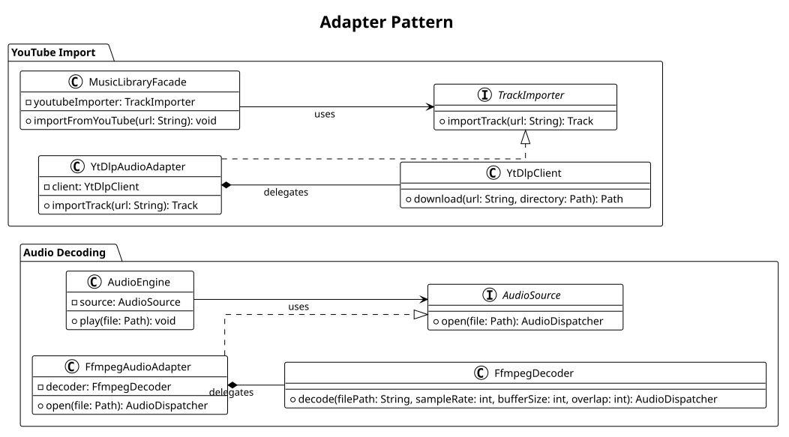
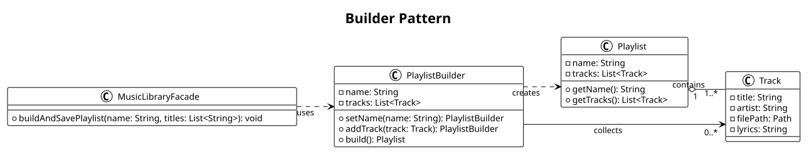
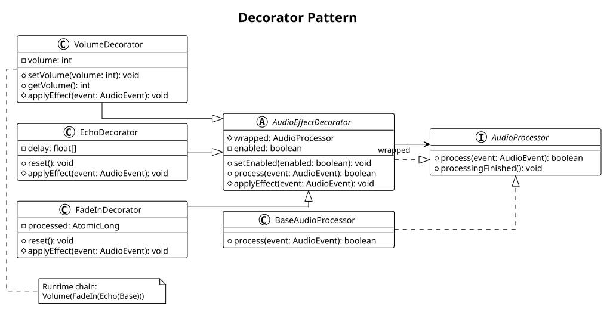
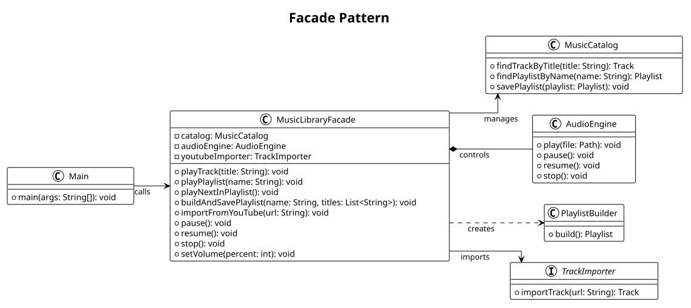
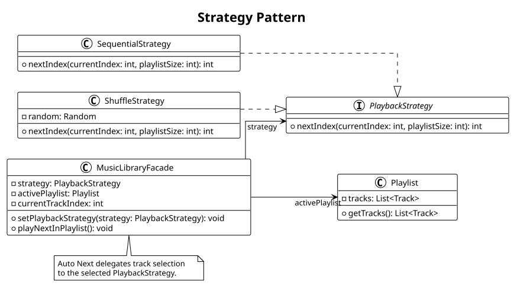
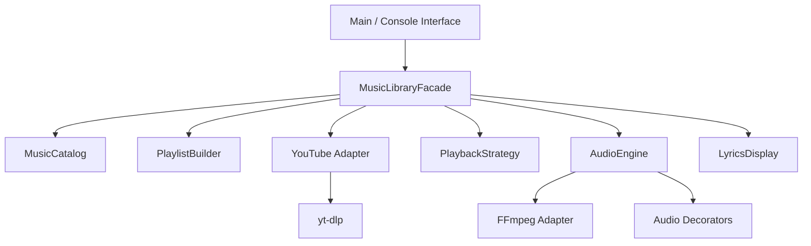

<div align="center">

# Music Streaming Service

### A Java Music Player Built with Six Design Patterns

A console-based music player featuring audio playback, YouTube importing, synchronized lyrics, playlists, and real-time audio effects.


**Astana IT University | Software Engineering | SE-2524**

</div>

---

## About the Project

**Music Streaming Service** is a Java 17 application developed for the Software Design Patterns course at Astana IT University.

The goal of the project is to demonstrate the practical application of six Gang of Four  design patterns in a music playback system.

The application integrates external audio tools, supports local music libraries and persistent playlists, and displays synchronized lyrics during playback.

Rather than implementing a commercial streaming platform, the project focuses on clean architecture, separation of responsibilities, and reusable object-oriented design.

## Features

- **Music Playback:** Play local audio files, including MP3, FLAC, M4A, and WebM.
- **YouTube Import:** Download audio from YouTube using yt-dlp.
- **Synchronized Lyrics:** Display timestamped lyrics from LRC files.
- **Playlist Management:** Create, save, load, and play playlists.
- **Playback Strategies:** Switch between sequential and shuffle playback.
- **Auto Next:** Automatically play the next song when a playlist track finishes.
- **Audio Effects:** Apply Echo and Fade In effects.
- **Volume Control:** Adjust the volume between 0% and 100%.
- **Playback Controls:** Play, pause, resume, stop, and skip to the next track.
- **Automated Testing:** Verify core functionality using JUnit 5.

## Repository Evolution

The following animation visualizes the development of the repository through its Git history.

<div align="center">


*Generated using [RepoReel](https://github.com/Loping151/reporeel).*

</div>

## Technologies

| Technology | Purpose |
|---|---|
| Java 17 | Main programming language |
| Apache Maven | Dependency management and build automation |
| TarsosDSP 2.5 | Audio processing and playback |
| FFmpeg | Audio decoding and format conversion |
| yt-dlp | YouTube audio and subtitle downloading |
| JUnit 5 | Automated unit testing |
| PlantUML | UML class diagrams |
| RepoReel | Git repository visualization |

---

## Installation

### Prerequisites

Make sure the following tools are installed:

- Java Development Kit (JDK) 17
- Apache Maven
- FFmpeg
- yt-dlp (required for YouTube importing)
- Git

### macOS

Install the external dependencies using Homebrew:

```bash
brew install maven ffmpeg yt-dlp
```

Install or configure JDK 17 separately if necessary.

Verify the installation:

```bash
java -version
mvn -version
ffmpeg -version
yt-dlp --version
```

### Windows

Install FFmpeg and yt-dlp using Windows Package Manager:

```powershell
winget install --id Gyan.FFmpeg -e
winget install --id yt-dlp.yt-dlp -e
```

Install JDK 17 and Maven separately if necessary.

Make sure the installed tools are available through the system PATH.

### Clone the Repository

```bash
git clone https://github.com/Qoshima/Music-Streaming-Service.git
```

Navigate to the project directory:

```bash
cd Music-Streaming-Service
```

### Build and Run

Build the project:

```bash
mvn clean compile
```

Run all unit tests:

```bash
mvn test
```

Start the application:

```bash
mvn exec:java -Dexec.mainClass=music.Main
```

Alternatively, open the Maven project in IntelliJ IDEA and run the `music.Main` class.

**Important:** Run the application from the project root so that relative audio and playlist paths resolve correctly.

---

## Console Commands

### Music Library

| Command | Description |
|---|---|
| `tracks` | Display all available tracks |
| `library` | Display the music library |
| `play <title>` | Play a song by its title |
| `play <file path>` | Play a local audio file |
| `youtube <URL>` | Import audio and available subtitles from YouTube |
| `yt <URL>` | Short version of the YouTube command |

### Playback Controls

| Command | Description |
|---|---|
| `pause` | Pause playback |
| `resume` | Resume playback |
| `stop` | Stop playback |
| `next` | Play the next track in the active playlist |

### Playlist Management

| Command | Description |
|---|---|
| `playlists` | Show saved playlists |
| `playlist <name> <songs>` | Create or replace a playlist |
| `playlist-play <name>` | Play a saved playlist |

### Playback Strategies

| Command | Description |
|---|---|
| `strategy sequential` | Play songs in sequential order |
| `strategy shuffle` | Play songs in random order |

### Audio Effects and Volume

| Command | Description |
|---|---|
| `echo on` | Enable Echo |
| `echo off` | Disable Echo |
| `fade on` | Enable Fade In |
| `fade off` | Disable Fade In |
| `volume <0-100>` | Set volume |
| `volume up` | Increase volume by 10% |
| `volume down` | Decrease volume by 10% |
| `volume` | Show current volume |
| `mute` | Mute the player |

### System

| Command | Description |
|---|---|
| `help` | Display available commands |
| `menu` | Display the command menu |
| `exit` | Exit the application |
| `quit` | Exit the application |

## Usage Examples

### Playing a Local Song

```text
Music > tracks

AVAILABLE TRACKS
----------------------------------------------
1. Test1 - Artist 1
2. Test2 - Artist 2
3. Test3 - Artist 3
4. Test4 - Artist 4

Music > play Test1
```

### Creating a Playlist

```text
Music > playlist Favorites Test1, Test2, Test3
Playlist saved successfully: Favorites
```

### Playing a Playlist

```text
Music > strategy sequential
Playback strategy: SequentialStrategy

Music > playlist-play Favorites
Starting playlist: Favorites
```

After a song finishes, the application automatically selects the next track using the active playback strategy.

The sequential strategy returns to the first track after reaching the end of the playlist.

### Importing from YouTube

```text
Music > youtube https://www.youtube.com/watch?v=VIDEO_ID
```

The application uses yt-dlp to:

1. Download the video's audio.
2. Convert the audio into MP3.
3. Attempt to download available subtitles.
4. Convert supported subtitles into LRC format.
5. Add the audio to the local music library.
6. Start playback.

Downloaded audio files are stored in:

```text
music/downloads/
```

**Note:** Subtitles depend on YouTube availability. Some videos do not provide subtitles, and automatically generated captions may differ from the actual song lyrics.

Download only content you are authorized to save.

### Synchronized Lyrics

When a matching LRC file is available, the Observer pattern displays lyrics according to playback position.

Example:

```text
[LYRICS] Track: Test1
[LYRICS] Welcome to Music Streaming Service
[LYRICS] Observer Pattern is running
[LYRICS] This is our synchronized lyrics demo
```

The Observer is notified when playback starts and periodically as the playback position changes.

---

## Design Patterns

The project implements **six Gang of Four design patterns**.

| Pattern | Main Classes | Purpose |
|---|---|---|
| Adapter | FfmpegAudioAdapter, YtDlpAudioAdapter | Integrate external tools through compatible interfaces |
| Builder | PlaylistBuilder, Playlist | Construct and validate playlists |
| Decorator | AudioEffectDecorator, EchoDecorator, FadeInDecorator, VolumeDecorator | Add audio-processing functionality dynamically |
| Facade | MusicLibraryFacade | Provide a simplified interface to the music system |
| Observer | Observer, LyricsDisplay | Display lyrics in synchronization with playback |
| Strategy | PlaybackStrategy, SequentialStrategy, ShuffleStrategy | Switch playback algorithms at runtime |

### 1. Adapter Pattern

The Adapter pattern allows the application to integrate external technologies without exposing their interfaces directly to the rest of the system.

**Implementations:**

- `AudioSource` — Target interface for audio decoding.
- `FfmpegAudioAdapter` — Adapts FFmpeg-based decoding.
- `FfmpegDecoder` — Performs decoding through TarsosDSP.
- `TrackImporter` — Target interface for importing tracks.
- `YtDlpAudioAdapter` — Converts downloaded audio into a `Track`.
- `YtDlpClient` — Executes yt-dlp commands.

<details>
<summary><b>View Adapter UML Diagram</b></summary>



[PlantUML Source](docs/uml/adapter.puml)

</details>

### 2. Builder Pattern

The Builder pattern separates playlist construction from its final representation.

`PlaylistBuilder` provides methods for setting the playlist name, adding tracks, and creating the completed playlist.

It validates that a playlist has a name and contains at least one track.

<details>
<summary><b>View Builder UML Diagram</b></summary>



[PlantUML Source](docs/uml/builder.puml)

</details>

### 3. Decorator Pattern

The Decorator pattern dynamically adds audio-processing functionality without modifying the basic audio component.

The system uses the following decorators:

- `EchoDecorator` — Adds an echo effect.
- `FadeInDecorator` — Gradually increases audio amplitude at the beginning.
- `VolumeDecorator` — Controls audio amplitude from 0% to 100%.

The processing chain is:

```text
VolumeDecorator
      |
FadeInDecorator
      |
EchoDecorator
      |
BaseAudioProcessor
```

<details>
<summary><b>View Decorator UML Diagram</b></summary>



[PlantUML Source](docs/uml/decorator.puml)

</details>

### 4. Facade Pattern

`MusicLibraryFacade` provides a unified interface to the application's main subsystems.

It coordinates:

- Audio playback
- Playlist creation and playback
- Playback strategies
- Observer notifications
- YouTube importing
- Audio effects and volume control

The `Main` class interacts with the Facade rather than directly controlling every subsystem.

<details>
<summary><b>View Facade UML Diagram</b></summary>



[PlantUML Source](docs/uml/facade.puml)

</details>

### 5. Observer Pattern

The Observer pattern establishes a notification mechanism between the playback system and lyrics display.

**Subject:** `MusicLibraryFacade`

**Observer interface:** `Observer`

**Concrete Observer:** `LyricsDisplay`

The Facade periodically provides the current track and playback position to registered observers.

`LyricsDisplay` uses `LrcParser` to identify the correct lyric line for the current timestamp.

<details>
<summary><b>View Observer UML Diagram</b></summary>


[PlantUML Source](docs/uml/observer.puml)

</details>

### 6. Strategy Pattern

The Strategy pattern allows the application to change its track-selection algorithm at runtime.

**Strategy interface:** `PlaybackStrategy`

**Concrete Strategies:**

- `SequentialStrategy` — Selects the next track in order.
- `ShuffleStrategy` — Selects a random track, avoiding an immediate repeat when possible.

The selected strategy is used by `MusicLibraryFacade`, including during automatic track transitions.

<details>
<summary><b>View Strategy UML Diagram</b></summary>



[PlantUML Source](docs/uml/strategy.puml)

</details>

---

## System Architecture

The system uses a modular architecture organized around responsibilities and design patterns.



### Project Structure

```text
Music-Streaming-Service/
|
|-- docs/
|   |-- media/
|   |   `-- repo-history.gif
|   |
|   `-- uml/
|       |-- adapter.puml / adapter.svg
|       |-- builder.puml / builder.svg
|       |-- decorator.puml / decorator.svg
|       |-- facade.puml / facade.svg
|       |-- observer.puml / observer.svg
|       `-- strategy.puml / strategy.svg
|
|-- music/
|   |-- test.mp3
|   |-- test.flac
|   |-- test.m4a
|   |-- test.webm
|   `-- test.lrc
|
|-- src/
|   |-- main/java/music/
|   |   |-- adapter/
|   |   |-- builder/
|   |   |-- data/
|   |   |-- decorator/
|   |   |-- facade/
|   |   |-- model/
|   |   |-- observer/
|   |   |-- player/
|   |   |-- strategy/
|   |   `-- Main.java
|   |
|   `-- test/java/music/
|       |-- builder/
|       |-- decorator/
|       |-- model/
|       |-- observer/
|       `-- strategy/
|
|-- pom.xml
`-- README.md
```

The application also creates local runtime files:

- `music/downloads/` — Downloaded audio and subtitle files.
- `playlists.properties` — Persisted playlist information.

These files are excluded from Git tracking.

---

## Unit Testing

The project uses **JUnit 5** to verify core application functionality.

### Run Tests

```bash
mvn clean test
```

### Test Coverage

| Test Class | Tests | Description |
|---|---:|---|
| StrategyTest | 4 | Sequential and shuffle track selection |
| PlaylistBuilderTest | 4 | Playlist creation and validation |
| MusicCatalogTest | 3 | Track and playlist lookup |
| LyricsTest | 3 | LRC parsing and Observer behavior |
| VolumeDecoratorTest | 2 | Volume settings and validation |
| **Total** | **16** | |

The unit tests focus on application logic without requiring active audio playback or a YouTube connection.

External audio decoding and downloads are verified separately during manual application testing.

---

## Troubleshooting

**FFmpeg is not found**

Verify that FFmpeg is installed and accessible from the terminal:

```bash
ffmpeg -version
```

**yt-dlp is not found**

Verify that yt-dlp is installed:

```bash
yt-dlp --version
```

**YouTube subtitles cannot be downloaded**

YouTube may restrict requests or not provide subtitles for a particular video. Audio downloading and subtitle retrieval are handled separately.

**Lyrics are not displayed**

Check that an LRC file exists alongside the audio file and has the same base filename.

**Audio files cannot be found**

Run the application from the project root directory.

**JUnit imports are unresolved in IntelliJ**

Reload the Maven project and ensure `src/test/java` is marked as a Test Sources Root.

---

## Project Team

**Astana IT University**

**Group: SE-2524**

- Yernur Alimbekov
- Ulzhan Musakhan
- Assel Yermekkyzy

---

<div align="center">

**Music Streaming Service**

*Software Design Patterns Course Project*

Built with Java 17 and six Design Patterns.

</div>